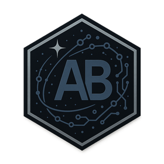
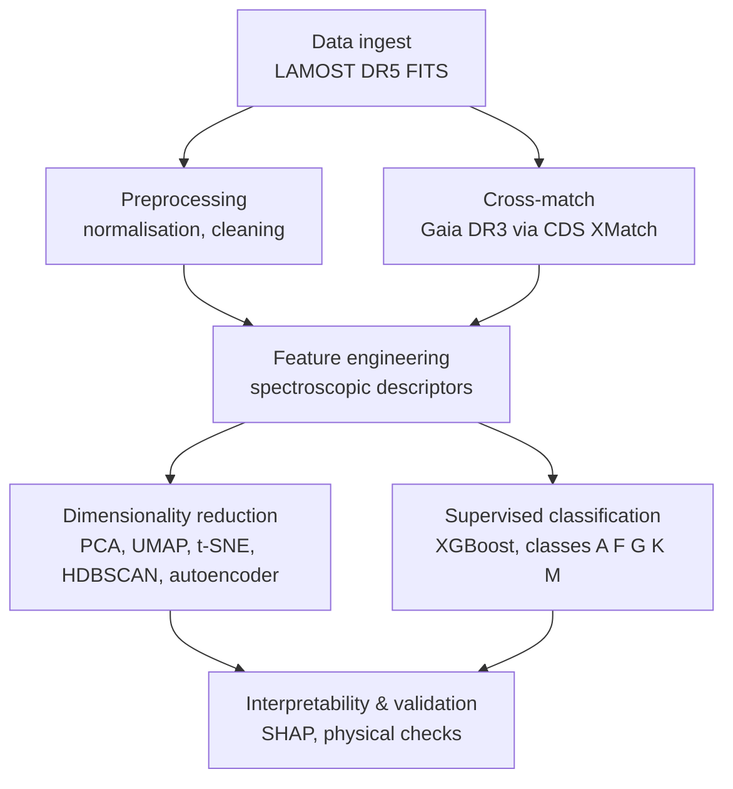

<div align="center">



<h1>✦ AstroSpectro Classification Pipeline ✦</h1>

<p><em>A modular, reproducible and interpretable pipeline for automated stellar spectral classification<br/>from raw <strong>LAMOST DR5</strong> spectra × <strong>Gaia DR3</strong>.</em></p>

<!-- Badges — row 1: stack -->
<p>
  <a href="https://www.python.org/"></a>
  <a href="https://xgboost.readthedocs.io/"></a>
  <a href="https://www.astropy.org/"></a>
  <a href="https://umap-learn.readthedocs.io/"></a>
  <a href="https://pytorch.org/"></a>
</p>

<!-- Badges — row 2: meta -->
<p>
  <a href="https://phd-brown.github.io/research-docs/docs/astrospectro"></a>
  <a href="https://github.com/PhD-Brown/AstroSpectro/releases"></a>
  <a href="https://github.com/PhD-Brown/AstroSpectro/blob/main/LICENSE"></a>
  <a href="https://github.com/PhD-Brown/AstroSpectro/commits/main"></a>
</p>

<br/>

**[Documentation](https://phd-brown.github.io/research-docs/docs/astrospectro)** &nbsp;·&nbsp;
**[Quick Start](https://phd-brown.github.io/research-docs/docs/astrospectro/guides/quick-start)** &nbsp;·&nbsp;
**[Key Results](https://phd-brown.github.io/research-docs/docs/astrospectro/overview/key-results)** &nbsp;·&nbsp;
**[Current Status](https://phd-brown.github.io/research-docs/docs/astrospectro/overview/current-status)** &nbsp;·&nbsp;
**[Report a Bug](https://github.com/PhD-Brown/AstroSpectro/issues)** &nbsp;·&nbsp;
**[Contact](mailto:albak1@ulaval.ca)**

</div>

---

## Table of Contents

- [About the Project](#-about-the-project)
- [Documentation](#-documentation)
- [Key Results](#-key-results)
- [Pipeline Architecture](#️-pipeline-architecture)
- [Getting Started](#-getting-started)
- [Project Structure](#️-project-structure)
- [Notebooks](#-notebooks)
- [Tech Stack](#️-tech-stack)
- [Roadmap](#-roadmap)
- [Contributing](#-contributing)
- [Citing AstroSpectro](#-citing-astrospectro)
- [License](#-license)
- [Contact](#️-contact)
- [Acknowledgements](#-acknowledgements)

---

## 🌌 About the Project

**AstroSpectro** is an end-to-end machine-learning pipeline for automated stellar spectral classification. It processes raw FITS spectra from the [LAMOST DR5](http://www.lamost.org/public/) survey, cross-matches them with [Gaia DR3](https://www.cosmos.esa.int/web/gaia/dr3), engineers physically motivated spectroscopic descriptors (line equivalent widths, prominences, widths, molecular-band and continuum indices), and studies them in two ways:

- **supervised classification** of the spectral types A, F, G, K, M with XGBoost, explained with SHAP;
- **unsupervised dimensionality reduction** (PCA, UMAP, t-SNE, HDBSCAN, convolutional autoencoder).

The project started as an undergraduate research project in physics at **Université Laval** (Québec City, Canada). Its guiding idea is that a classifier is only useful if one can check *what* it learned: SHAP attributions and physical validation tests are part of the pipeline, not an afterthought, and known problems are documented as openly as results.

---

## 📚 Documentation

The full documentation lives in a dedicated site, **[research-docs](https://phd-brown.github.io/research-docs/docs/astrospectro)** ([source](https://github.com/PhD-Brown/research-docs)), shared with the author's other research projects. This README only gives an overview; the documentation is the reference.

| To… | Read |
|:----|:-----|
| Understand the project | [What is AstroSpectro?](https://phd-brown.github.io/research-docs/docs/astrospectro/overview) · [Project Map](https://phd-brown.github.io/research-docs/docs/astrospectro/overview/project-map) |
| Install it and run it once | [Installation](https://phd-brown.github.io/research-docs/docs/astrospectro/guides/installation) · [Quick Start](https://phd-brown.github.io/research-docs/docs/astrospectro/guides/quick-start) |
| Follow each processing step | [Core Pipeline](https://phd-brown.github.io/research-docs/docs/astrospectro/pipeline) · [User Guides](https://phd-brown.github.io/research-docs/docs/astrospectro/guides) |
| See the results | [Key Results](https://phd-brown.github.io/research-docs/docs/astrospectro/overview/key-results) · [Classification Performance](https://phd-brown.github.io/research-docs/docs/astrospectro/science/classification-performance) · [SHAP](https://phd-brown.github.io/research-docs/docs/astrospectro/science/shap-interpretability) · [Dimensionality Reduction](https://phd-brown.github.io/research-docs/docs/astrospectro/dimred) |
| Know what is wrong or unfinished | [Current Status](https://phd-brown.github.io/research-docs/docs/astrospectro/overview/current-status) · [Data Leakage Audit](https://phd-brown.github.io/research-docs/docs/astrospectro/concepts/data-leakage-audit) · [Limitations](https://phd-brown.github.io/research-docs/docs/astrospectro/science/limitations) |
| Use the code | [API Reference](https://phd-brown.github.io/research-docs/docs/astrospectro/api) |

---

## 📊 Key Results

The project has two studies on **two different datasets**. Their numbers must not be compared or combined.

### Reference classifier — XGBoost v6 (349,998 spectra processed)

| Metric | Value |
|:-------|:-----:|
| Balanced accuracy | **89.2 %** |
| ROC-AUC (macro, one-vs-rest) | **0.986** |
| F1 (macro) | **0.883** |
| Classes | A · F · G · K · M |
| Features | 207 candidates → 99 selected |

> [!WARNING]
> Run v6 (`ST_350k_xgb_AFGKM_v6`) was trained with `spectro_only` enabled, but its 99 selected features include four Gaia/photometric columns (`M_G`, `M_BP`, `M_RP`, `ag_gspphot`). Its metrics are therefore not purely spectroscopic; see the [Data Leakage Audit](https://phd-brown.github.io/research-docs/docs/astrospectro/concepts/data-leakage-audit). The cause is the prefix-based `spectro_only` exclusion in `src/pipeline/classifier.py`; The exclusion now uses an explicit denylist in `src/pipeline/classifier.py`; a complete spectroscopic-only reference run is still to come.

On this run, **96.8 %** of the total SHAP importance falls on spectroscopic features (3.2 % on the Gaia/photometric ones); the three most important features are the Mg b equivalent width, the CaH2 molecular band and the deep-red continuum slope.

### Dimensionality reduction — PHY-3500 · G1 · 43,019 spectra

| Analysis | Result |
|:---------|:-------|
| PCA on the 183 descriptors | 91 components for 95 % of the variance · PC1 tracks temperature (Spearman ρ with Gaia T_eff = +0.831) |
| UMAP + HDBSCAN | 20 clusters, 6.14 % noise |
| Autoencoder (2-D latent space) | Reconstruction MSE 0.489, versus 0.696 for a 2-component PCA |

Details, figures and run identifiers: **[Key Results](https://phd-brown.github.io/research-docs/docs/astrospectro/overview/key-results)**. The documentation is updated with each new reference run; this table is only refreshed when the reference run changes.

---

## 🏗️ Pipeline Architecture



Step-by-step description: [Pipeline Overview](https://phd-brown.github.io/research-docs/docs/astrospectro/pipeline).

---

## 🚀 Getting Started

### Option 1 — GitHub Codespaces (1-click)

1. Click **`<> Code`** at the top of this page
2. Open the **`Codespaces`** tab
3. Click **`Create codespace on main`**

[](https://github.com/codespaces/new?hide_repo_select=true&ref=main&repo=1015730251)

Once loaded, open `notebooks/00_master_pipeline.ipynb`.

### Option 2 — Local installation

**Prerequisites:** Python **3.11** (required by `pyproject.toml`), Git, and optionally an NVIDIA GPU with CUDA for autoencoder training.

```bash
# 1. Clone
git clone https://github.com/PhD-Brown/AstroSpectro.git
cd AstroSpectro

# 2. Virtual environment
python3.11 -m venv .venv
source .venv/bin/activate            # Windows: .\.venv\Scripts\Activate.ps1

# 3. Install
python -m pip install --upgrade pip
python -m pip install -e . -r requirements.txt

# 4. Jupyter kernel
python -m ipykernel install --user --name astrospectro --display-name "AstroSpectro (Py3.11)"

# 5. Credentials (optional — anonymous access works for most tasks)
cp .env.example .env                 # Windows: copy .env.example .env
```

In `.env`, set `WANDB_API_KEY` for experiment tracking and optionally `GAIA_USER` / `GAIA_PASS`. Then open `notebooks/00_master_pipeline.ipynb` with the **AstroSpectro (Py3.11)** kernel.

Full walkthrough: **[Installation](https://phd-brown.github.io/research-docs/docs/astrospectro/guides/installation)** · **[Quick Start](https://phd-brown.github.io/research-docs/docs/astrospectro/guides/quick-start)**.

---

## 🗂️ Project Structure

```
AstroSpectro/
├── notebooks/                      # Orchestration and analysis
│   ├── 00_master_pipeline.ipynb       # Entry point: batch → catalogue → features → training
│   ├── 01_download_spectra.ipynb      # LAMOST DR5 download
│   ├── 02_tools_and_visuals.ipynb     # Exploration and figures
│   ├── 03_scientific_validation.ipynb # Physical validation
│   ├── 04_shap_interpretability.ipynb # SHAP analysis
│   └── dimred/                        # PHY-3500 dimensionality-reduction notebooks (PCA, UMAP/t-SNE, autoencoder)
│
├── src/
│   ├── pipeline/                   # Scientific processing chain
│   │   ├── preprocessor.py            # FITS reading, normalisation
│   │   ├── peak_detector.py           # Spectral line detection
│   │   ├── feature_engineering.py     # Spectroscopic descriptors
│   │   ├── processing.py              # Parallel batch processing
│   │   ├── classifier.py              # XGBoost classifier, spectro_only filter
│   │   ├── wandb_config.py            # Experiment tracking
│   │   └── master.py                  # Pipeline orchestrator
│   ├── tools/                      # Data management and interfaces
│   │   ├── dr5_downloader.py          # LAMOST DR5 downloader
│   │   ├── spectra_manager.py, dataset_builder.py, generate_catalog_from_fits.py
│   │   ├── gaia_crossmatcher.py       # Gaia DR3 cross-match
│   │   └── visualizer.py              # Interactive visual tools
│   ├── dimred/                     # PCA, UMAP/t-SNE, HDBSCAN, autoencoder, run reports
│   └── utils.py                    # Project paths and helpers
│
├── data/                           # Raw FITS, catalogues, features, models, reports (gitignored)
├── scripts/                        # Environment setup and clean-up
├── .devcontainer/                  # GitHub Codespaces configuration
├── app.py
├── pyproject.toml
├── requirements.txt
└── ROADMAP.md
```

Module-by-module description: [Project Map](https://phd-brown.github.io/research-docs/docs/astrospectro/overview/project-map).

---

## 🧪 Notebooks

| Notebook | Purpose |
|:---------|:--------|
| `00_master_pipeline.ipynb` | **Entry point** — runs the pipeline end to end |
| `01_download_spectra.ipynb` | Bulk LAMOST DR5 FITS download from validated plan URLs |
| `02_tools_and_visuals.ipynb` | Exploration: spectra, SNR, colours, sky coverage |
| `03_scientific_validation.ipynb` | Gaia DR3 cross-match and physical validation of the features |
| `04_shap_interpretability.ipynb` | SHAP attributions of the classifier |
| `dimred/phy3500_01_pca.ipynb` | PCA: variance, eigenspectra, loadings |
| `dimred/phy3500_02_umap_tsne.ipynb` | UMAP, t-SNE, Procrustes stability, HDBSCAN |
| `dimred/phy3500_03_autoencoder.ipynb` | Convolutional autoencoder: reconstruction and latent space |

---

## 🛠️ Tech Stack

| Layer | Technology |
|:------|:-----------|
| **Language** | Python 3.11 |
| **Classification** | XGBoost · scikit-learn · imbalanced-learn |
| **Deep learning** | PyTorch (convolutional autoencoder) |
| **Dimensionality reduction & clustering** | scikit-learn (PCA, t-SNE) · UMAP-learn · HDBSCAN |
| **Astronomy** | Astropy · astroquery |
| **Cross-match** | Gaia DR3 via CDS XMatch (`vizier:I/355/gaiadr3`) |
| **Interpretability** | SHAP |
| **Experiment tracking** | Weights & Biases |
| **Visualisation** | Matplotlib · Seaborn · Plotly |
| **Documentation** | [research-docs](https://github.com/PhD-Brown/research-docs) (separate repository) |
| **Dev environment** | GitHub Codespaces · VS Code devcontainer |

The reference run v6 was produced with Python 3.11.9, scikit-learn 1.7.2 and XGBoost 3.1.1.

> **Note on ESA Gaia TAP:** upload-based TAP queries to the ESA endpoint proved unreliable. **CDS XMatch** (`astroquery.xmatch.XMatch`) against `vizier:I/355/gaiadr3` is the alternative used throughout this project.

---

## 🧭 Roadmap

Next steps:

- [ ] A complete spectroscopic-only reference run (corrected exclusion list, complete Gaia cross-match, full SHAP analysis) to replace v6
- [ ] Systematic hyperparameter optimisation (Optuna)
- [ ] Dimensionality reduction on the larger dataset
- [ ] A short manuscript on the classifier

Full list: [Roadmap](https://phd-brown.github.io/research-docs/docs/astrospectro/community/roadmap) · [Current Status](https://phd-brown.github.io/research-docs/docs/astrospectro/overview/current-status) · [`ROADMAP.md`](ROADMAP.md) (detailed task list, in French).

---

## 🤝 Contributing

Contributions, questions and collaborations are welcome — especially from astronomers, ML practitioners and fellow students.

1. **Fork** the repository and clone your fork
2. **Create a branch** (`git checkout -b feature/my-contribution`)
3. **Commit** with descriptive messages (`pre-commit` runs `black` and `ruff`)
4. **Push** and open a **Pull Request** describing what changed and why

Read the **[Contribution Guide](https://phd-brown.github.io/research-docs/docs/astrospectro/community/contributing)** first. For questions or ideas, open a [Discussion](https://github.com/PhD-Brown/AstroSpectro/discussions).

---

## 📝 Citing AstroSpectro

If you use AstroSpectro in your research or coursework, please cite it:

```bibtex
@software{baker2026astrospectro_software,
  author  = {Baker, Alex},
  title   = {AstroSpectro: Interpretable ML Pipeline for Stellar Spectral Classification},
  year    = {2026},
  url     = {https://github.com/PhD-Brown/AstroSpectro},
  version = {1.0.0}
}
```

See the **[Citation Guide](https://phd-brown.github.io/research-docs/docs/astrospectro/community/citing)** for the plain-text form and how to credit LAMOST and Gaia.

---

## 📄 License

Distributed under the **MIT License**. See [`LICENSE`](LICENSE).

---

## ✉️ Contact

**Alex Baker** — Physics undergraduate, Université Laval (Québec City, Canada)

- Email: [albak1@ulaval.ca](mailto:albak1@ulaval.ca)
- GitHub: [@PhD-Brown](https://github.com/PhD-Brown)
- Documentation: [phd-brown.github.io/research-docs](https://phd-brown.github.io/research-docs/docs/astrospectro)

---

## 🙏 Acknowledgements

- **[LAMOST](http://www.lamost.org/public/)** — Large Sky Area Multi-Object Fiber Spectroscopic Telescope, for the DR5 data.
- **[Gaia DR3](https://www.cosmos.esa.int/web/gaia/dr3)** — ESA Gaia mission, for astrometry and astrophysical parameters.
- **[CDS / VizieR](https://vizier.cds.unistra.fr/)** — Centre de Données astronomiques de Strasbourg, for the cross-match service.
- **[Astropy Project](https://www.astropy.org/)** — the community Python package for astronomy.
- **[Weights & Biases](https://wandb.ai/)** — experiment tracking.

Full list: [Acknowledgements](https://phd-brown.github.io/research-docs/docs/astrospectro/community/acknowledgements).

---

<div align="center">

*Built with curiosity, a Ryzen 9, and way too many W&B runs* ☕🔭


&nbsp;


*Copyright © 2026 Alex Baker — MIT License*

</div>
